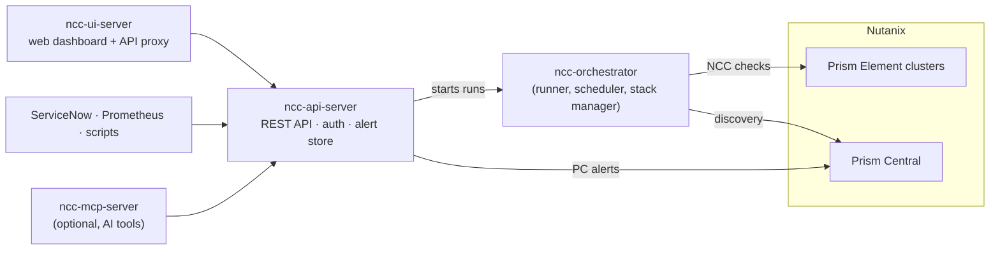

# Nutanix NCC Orchestrator

[](docs/releases/RELEASE_NOTES_v2.2.1.md)
[](go.mod)
[](frontend/package.json)
[](LICENSE)
[](docs/releases/RELEASE_NOTES_v2.2.1.md)

Run **Nutanix Cluster Check (NCC)** across many clusters in parallel, collect the results in one place, and work through them in a web dashboard — with history, alert handling, scheduling, RBAC/SSO, and an API for ServiceNow, Prometheus, and other tools.

> Independent open-source project. Not affiliated with or endorsed by Nutanix, Inc.

---

## Contents

- [Highlights](#highlights)
- [How it fits together](#how-it-fits-together)
- [Quick start](#quick-start)
- [Configuration](#configuration)
- [Web dashboard](#web-dashboard)
- [Alerts and integrations](#alerts-and-integrations)
- [HTTP API](#http-api)
- [Security](#security)
- [Operating the stack](#operating-the-stack)
- [Verifying release binaries](#verifying-release-binaries)
- [Exit codes and output files](#exit-codes-and-output-files)
- [Upgrading to v2.2.1](#upgrading-to-v221)
- [Documentation](#documentation)
- [Development](#development)

---

## Highlights

- **Parallel NCC runs** over Prism Element clusters (listed directly or discovered from Prism Central), with retries, adaptive back-off on HTTP 429, and per-cluster reports in HTML, CSV, JSON, Markdown, and SARIF.
- **Web dashboard** with FAIL/WARN/ERR/INFO triage, Prism Central alerts, run history, trends, regressions, and flaky-check detection.
- **Alert lifecycle**: acknowledge, resolve, and reopen NCC findings; every alert instance gets a UUID and an append-only history, and the dashboard shows how long it has been open and whether it keeps coming back.
- **Integrations**: REST API with an OpenAPI 3 spec, personal access tokens, an incremental event feed for ticketing tools, Prometheus `/metrics`, email/webhook/Slack notifications, and an MCP server for AI assistants.
- **Secure by default**: HTTPS UI, role-based access (viewer / operator / admin), local accounts, LDAP/AD, SAML SSO, encrypted backups, rate limiting, and strict security headers.
- **Runs anywhere**: single binaries for Linux, macOS, and Windows; a self-healing supervisor; Docker Compose; Kubernetes (kustomize or Helm).
- **CI-friendly**: policy gates turn run results into exit codes.

## How it fits together



| Binary | Source | Role |
| --- | --- | --- |
| `ncc-orchestrator` | [`cmd/ncc-orchestrator`](cmd/ncc-orchestrator) | Runs NCC on many clusters, writes reports, schedules runs, and manages the API + UI stack (`v2-start`, `v2-status`, …) |
| `ncc-api-server` | [`cmd/ncc-api-server`](cmd/ncc-api-server) | REST API: runs, reports, alert lifecycle, settings, users, audit log, metrics |
| `ncc-ui-server` | [`cmd/ncc-ui-server`](cmd/ncc-ui-server), [`frontend/`](frontend) | Serves the React dashboard and proxies `/api` to the API server |
| `ncc-mcp-server` | [`cmd/ncc-mcp-server`](cmd/ncc-mcp-server) | Optional [Model Context Protocol](docs/MCP_SERVER.md) bridge for AI assistants |

Each binary runs on its own. Use the CLI alone for batch or cron jobs, or the full stack for the dashboard.

---

## Quick start

| I want to… | Use |
| --- | --- |
| Run a scan from the command line | [Release archive → one-shot scan](#1-download-a-release) |
| Run the dashboard on a VM or laptop | [Full stack with `v2-start`](#2-start-the-full-stack) |
| Run the dashboard in containers | [Docker Compose](#docker-compose) |
| Deploy to a cluster | [Kubernetes](#kubernetes) |
| Hack on the code | [Build from source](#build-from-source) |

### 1. Download a release

Each [release](https://github.com/lTSPV75BRO/Nutanix-ncc-orchestrator/releases) has a stack archive per platform (`ncc-v2-stack-<os>-<arch>.tar.gz`, `.zip` on Windows). It contains `bin/` (`ncc-orchestrator`, `ncc-api-server`, `ncc-ui-server`), `frontend-dist/`, and `example_config.yaml` **at the top level**, so extract it into its own folder:

```bash
VERSION=v2.2.1
BASE=https://github.com/lTSPV75BRO/Nutanix-ncc-orchestrator/releases/download/$VERSION
curl -LO $BASE/ncc-v2-stack-linux-amd64.tar.gz
curl -LO $BASE/checksums.txt
sha256sum -c checksums.txt --ignore-missing     # macOS: shasum -a 256 -c …

mkdir ncc && tar -xzf ncc-v2-stack-linux-amd64.tar.gz -C ncc && cd ncc
```

Edit `example_config.yaml`: replace the sample cluster `REPLACE_WITH_CLUSTER_IP` and set the username. The template refers to four secrets — `NCC_PASSWORD` (Prism), `SMTP_PASSWORD`, `WEBHOOK_HMAC`, and `SLACK_WEBHOOK_URL`. Export the ones you use and delete the notification blocks you don't, otherwise the run stops with `secret "…" not found`.

```bash
export NCC_PASSWORD='your-prism-password'
./bin/ncc-orchestrator validate-config --config example_config.yaml
./bin/ncc-orchestrator preflight-check --config example_config.yaml   # config + secrets + paths

# One-shot scan (there is no "run" subcommand; the root command runs the scan)
./bin/ncc-orchestrator --config example_config.yaml
```

Reports are written to `outputfiles/`; open `outputfiles/index.html` for the combined view. Prefer guided setup? Try `./bin/ncc-orchestrator quickstart`.

### 2. Start the full stack

From the extracted folder, the stack finds its own config, output, log, and token paths:

```bash
./bin/ncc-orchestrator v2-check  --api-listen 127.0.0.1:8081 --ui-listen :8080   # paths, ports, binaries
./bin/ncc-orchestrator v2-start  --api-listen 127.0.0.1:8081 --ui-listen :8080   # foreground

# or in the background, restarted automatically if a process dies or hangs
./bin/ncc-orchestrator v2-start --detach --self-heal --api-listen 127.0.0.1:8081 --ui-listen :8080
./bin/ncc-orchestrator v2-status
./bin/ncc-orchestrator v2-stop
```

Open **<https://localhost:8080>**. The UI uses HTTPS by default with a generated self-signed certificate (stored under `tls/`); `--ui-insecure-http` serves plain HTTP for a trusted loopback setup.

**First login:** the first start creates an `admin` account with a random password, printed once in the API log (search for `FIRST-RUN ADMIN`) and saved to `.ncc-initial-admin-password` in the install folder. You must change it at first login; the file is then deleted. To install the stack as a boot-time service, see `v2-install-service`.

### Docker Compose

```bash
git clone https://github.com/lTSPV75BRO/Nutanix-ncc-orchestrator.git
cd Nutanix-ncc-orchestrator

mkdir -p config && cp examples/example_config.yaml config/config.yaml   # then edit it
echo "NCC_PASSWORD=<your-prism-password>" > .env                 # forwarded to runs

docker compose up -d --build
docker compose ps        # both services should become "healthy"
```

- UI: **<http://localhost:8080>** (plain HTTP in this compose setup; put a TLS proxy in front for anything but local use)
- API: `127.0.0.1:8081` (loopback only)
- State (reports, logs, audit, schedule, token) lives in named volumes. `docker compose down` keeps them; `down -v` deletes them.

The UI starts only after the API passes its health check and has written the shared token file.

### Kubernetes

```bash
kubectl apply -k k8s/          # runner CronJob + API + UI + NetworkPolicies
```

Create `ncc-v2-secrets` first with the Prism password, API token, and a `jwt-secret` (`openssl rand -base64 32`); add `backup-key` and `master-key` if you want encrypted backups and an encrypted user store. The kustomize manifests run 1 API and 2 UI replicas; the [Helm chart](helm/ncc-orchestrator/README.md) runs 2 of each. See [`k8s/README.md`](k8s/README.md) for TLS, backups, and rollback.

Published images (Docker Hub): `prajwalnutant/nutanix-ncc-orchestrator`, `prajwalnutant/ncc-api-server`, and `prajwalnutant/ncc-ui-server`, tagged with the version (for example `:2.2.1`).

### Build from source

Requires **Go 1.27.3+** (the `go` directive in [`go.mod`](go.mod)) and **Node.js 26.12.1+** (the first 26.x with the CVE-2026-111497 fix).

```bash
git clone https://github.com/lTSPV75BRO/Nutanix-ncc-orchestrator.git
cd Nutanix-ncc-orchestrator

go build -o ncc-orchestrator ./cmd/ncc-orchestrator
go build -o ncc-api-server   ./cmd/ncc-api-server
go build -o ncc-ui-server    ./cmd/ncc-ui-server
go build -o ncc-mcp-server   ./cmd/ncc-mcp-server     # optional

(cd frontend && npm ci && npm run build)              # dashboard → frontend/dist

./ncc-orchestrator v2-start --config-path examples/example_config.yaml --api-listen 127.0.0.1:8081 --ui-listen :8080
```

`go build ./...` only compile-checks; use `-o` as above to get the binaries. Release builds for every platform come from [`scripts/binaryGO.txt`](scripts/binaryGO.txt) (`bash scripts/binaryGO.txt`, or `scriptsinaryGO.cmd` on Windows); see [`docs/BUILD_FROM_SCRATCH.md`](docs/BUILD_FROM_SCRATCH.md).

---

## Configuration

[`examples/example_config.yaml`](examples/example_config.yaml) is the reference template; every option has a comment naming its CLI flag and `NCC_` environment variable. Settings are applied in this order (later wins):

1. Built-in defaults
2. YAML config (nested schema v1; legacy flat keys still work)
3. `NCC_*` environment variables
4. Platform/deployment overlay
5. CLI flags

`ncc-orchestrator env-info` lists the supported variables (secrets masked); `ncc-orchestrator config-schema` prints the JSON schema. Every key, variable, and flag is documented in [`docs/FEATURES_AND_CONFIG_FLAGS.md`](docs/FEATURES_AND_CONFIG_FLAGS.md).

### Secrets

Plaintext credentials in config files are rejected by `validate-secrets`. Reference secrets instead:

```yaml
secrets:
  provider: env            # or: file, with  file: /run/secrets/ncc.yaml
runner:
  credentials:
    password: "secret://NCC_PASSWORD"
```

### Policy gates

Fail a run (non-zero exit) when results cross a threshold — useful in CI/CD:

```yaml
policy-gates: "new-fails>0,fail-rate>2,min-health-score<90,flaky-checks>5"
```

Metrics: `new-fails`, `resolved-fails`, `fail-rate`, `clusters-failed`, `regressions`, `flaky-checks`, `min-health-score`, `avg-health-score`. Operators: `>`, `>=`, `<`, `<=`, `==`, `!=`. Violations are written to `outputfiles/policy-gates.txt`.

---

## Web dashboard

- **Dashboard** — latest run at a glance, an alerts table for **NCC** findings or **PC · Beta** (live Prism Central alerts), filters kept in the URL (**Copy link** shares the exact view). Clicking an NCC alert opens a panel to acknowledge, resolve, or reopen it, with its **Lifecycle**: how long it has been open, when a run last reported it, how many times it came back after being resolved (and who resolved it last), and severity changes.
- **Runs** — start a run, follow its output, cancel a stuck run, and browse past runs with status, duration, and cluster counts.
- **Insights** — trends, regressions, flaky checks, run-to-run diffs, the NCC triage queue, and **Alert aging and recurrence**: open alerts by age per cluster, median time to acknowledge and resolve, findings that keep coming back, and open alerts that runs no longer report (resolvable in place).
- **Settings** — config (form or YAML editor), schedule, notifications, users and access (local, LDAP/AD, SAML), HTTPS certificate, software updates, backups, audit log, feature switches, and system health. Operators see only Connection, Schedule, Runs, Logs, and Audit. **Ctrl+K / ⌘K** jumps to any setting.

Light, Dark, IT Professional, or follow the system theme; keyboard friendly; strict Content Security Policy (`script-src 'self'`). Optional views (Insights, Prism Central alerts, run comparison, flaky checks, SLO, NCC log index) can be turned off by an admin in **Settings → Features**.

---

## Alerts and integrations

**NCC alert lifecycle.** Each NCC finding becomes an alert instance with a server-generated UUIDv4. Acknowledge, resolve, and reopen actions, plus run-driven events (detected, no longer reported, severity changed, came back), are kept in an append-only history. If a resolved finding is detected again, the old instance is closed and a new one opens, linked to it. The store is `.ncc-api-alert-lifecycle.json` in the install folder — outside `outputfiles/`, so report retention never deletes it — and is included in `v2-backup`. `outputfiles/ncc-alert-dispositions.json` is kept only as a mirror for rolling back to v2.2.0.

**Prism Central alerts.** Configure `pcs` or `prism-central-url` and pick **PC · Beta** on the dashboard. Alerts are fetched on demand, cached briefly (`pc-alerts-cache-ttl`, default `5m`), and keep their own status in Prism Central.

**Third-party tools.** ServiceNow, SIEMs, and scripts can poll `GET /api/v1/alerts/ncc` and the incremental `GET /api/v1/alerts/ncc/events` feed with a viewer [personal access token](#http-api), and write back with `POST /api/v1/alerts/ncc/{id}/resolve`. The OpenAPI spec includes typed schemas for these endpoints. Step-by-step guide, field mappings, and examples: [`docs/integrations/third-party-alert-integrations.md`](docs/integrations/third-party-alert-integrations.md). Prometheus setup: [`Prometheus.md`](docs/PROMETHEUS.md).

---

## HTTP API

The full route list is at `GET /api/v1/meta/routes`, the OpenAPI 3 spec at `GET /api/v1/openapi.json`, and an interactive explorer at `/docs/ui` on the API server.

| Path | Methods | Purpose |
| --- | --- | --- |
| `/api/v1/health` | GET | Liveness; admins see paths and detail, anonymous callers only status |
| `/api/v1/runs/trigger` | POST | Start a run (one at a time; `409` if one is running) |
| `/api/v1/runs`, `/runs/{id}`, `/runs/summary` | GET | Run history, one run with artifacts, latest summary |
| `/api/v1/runs/active` | GET, DELETE | Current run; `DELETE` cancels it |
| `/api/v1/runs/preflight` | POST | Preflight check with machine-readable remediation codes |
| `/api/v1/report/data`, `/report/trends` | GET | Report data (paged with `limit`/`offset`) and trends |
| `/api/v1/alerts/ncc` | GET | NCC alert instances; filter by `state`, `detection`, `cluster`, `check`, `updated_since`; cursor paging |
| `/api/v1/alerts/ncc/events` | GET | Append-only lifecycle events; pass `next_cursor` back to get only new ones |
| `/api/v1/alerts/ncc/{id}` | GET | One alert with its full history and related instances |
| `/api/v1/alerts/ncc/{id}/{action}` | POST | `acknowledge`, `resolve`, or `reopen` (operator+) |
| `/api/v1/alerts/ncc-dispositions` | GET, POST | v2.2.0-compatible view of NCC marks (used by the dashboard) |
| `/api/v1/alerts` | GET | Prism Central alerts (`resolved=No\|Yes\|all`) |
| `/api/v1/schedule`, `/schedule/health` | GET, PUT | Run schedule and its last result |
| `/api/v1/artifacts`, `/artifacts/{name}` | GET | Generated report files |
| `/api/v1/audit` | GET | Audit log |
| `/api/v1/features` | GET, PUT | Optional views (PUT is admin-only) |
| `/api/v1/auth/login`, `/logout`, `/me` | POST, GET | Sessions and current identity |
| `/api/v1/users/me/pats` | GET, POST | Personal access tokens |
| `/api/v1/settings/*` | various | Configuration, users, TLS, backups, notifications (admin) |
| `/metrics` | GET | Prometheus metrics |

**Authentication.** Send `X-API-Token: <token>` or `Authorization: Bearer <token>`. Tokens can be the static admin/viewer tokens (`NCC_API_TOKEN`, `NCC_API_VIEWER_TOKEN`), a browser session, or a **personal access token** (`ncc_pat_…`, created from the user menu; inherits the owner's role, optionally expiring, revocable). Errors use one envelope: `{"success": false, "error": "…", "error_code": "NCC_API_…"}`.

**Roles.** `viewer` reads; `operator` also starts/cancels runs, manages the schedule, and handles alerts; `admin` can do everything, including `/api/v1/settings/*`. Admins can confine users to **cluster groups**; an ungrouped user sees all clusters.

```bash
TOKEN=$(cat .ncc-api-token)
curl -s -X POST http://127.0.0.1:8081/api/v1/runs/trigger \
  -H "X-API-Token: $TOKEN" -H "Content-Type: application/json" \
  -d '{"config":"example_config.yaml"}'
```

Extra run arguments (`extra_args`) are checked against a server-side allow-list.

---

## Security

| Area | Default behavior |
| --- | --- |
| Sign-in | Local accounts (bcrypt), LDAP / Active Directory, and SAML SSO; first-run admin with a forced password change; offline recovery with `v2-reset-password` |
| Sessions | httpOnly session cookies, `Secure` when served over HTTPS, CSRF protection on changes; `NCC_JWT_SECRET` shares sessions across API replicas |
| Login protection | Rate limits per account, per source, and per account+source; progressive lockout; `X-Forwarded-For` honored only from `--trusted-proxy-cidrs` |
| Transport | UI is HTTPS by default (self-signed or your own certificate, managed in **Settings → Access → HTTPS / TLS**); optional API TLS and mTLS |
| Prism TLS | Verified by default; trust an internal CA with `--ca-bundle` or pin with `--pin-sha256` instead of `--insecure-skip-verify` |
| Backups | Encrypted (AES-256-GCM) by default; a backup key or passphrase is required unless `NCC_BACKUP_ENCRYPTION=optional` |
| User store | Optional envelope encryption with a master key (`--require-encrypted-user-store` to enforce it) |
| Hardening | Rate limiting on sensitive routes, request size and header limits, path confinement for file access, CORS allow-list (no wildcards), CSP, `X-Frame-Options: DENY`, HSTS on TLS |
| Audit | Every change is audited; rotated logs are kept (`--audit-log-keep`, default 10) and can be forwarded |
| Supply chain | `govulncheck`, `npm audit --omit=dev`, golangci-lint, CodeQL, and Trivy in CI; SHA-256 checksums, CycloneDX SBOMs, and SLSA provenance attestations for releases |

Details: [`docs/SECURITY_AND_TRUST.md`](docs/SECURITY_AND_TRUST.md) and the [October 2026 security assessment](docs/security/security-assessment-2026-10.md).

---

## Operating the stack

| Task | Command |
| --- | --- |
| Status of every process (PID, listen address, health, log) | `ncc-orchestrator v2-status` (`--json` for scripts) |
| Collect diagnostics into a redacted support bundle | `ncc-orchestrator doctor` |
| Restart the stack | `ncc-orchestrator v2-restart` |
| Start at boot (systemd, Windows Task Scheduler, or launchd) | `ncc-orchestrator v2-install-service` (`--print-only` to preview) |
| Back up / restore config, users, tokens, and state | `ncc-orchestrator v2-backup` / `v2-restore` |
| Update to the latest release | `ncc-orchestrator update --check`, then `update` (or **Settings → Access → Updates**) |
| Recover a lost password | `ncc-orchestrator v2-reset-password --user admin` |
| Shell completion | `ncc-orchestrator completion bash\|zsh\|fish\|powershell` |

**Self-healing.** `v2-start --detach --self-heal` (or the boot-time service) restarts a crashed or hung API/UI process using each server's built-in `--health-check` probe, with exponential back-off and a restart budget per window (`--self-heal-max-restarts`, `--self-heal-window`, `--self-heal-probe-interval`, `--self-heal-unhealthy-threshold`).

**Metrics.** The API server exposes Prometheus metrics at `/metrics` (build info, run counters, per-cluster health and severity counts from the latest run, rate-limit and alert-store gauges). It needs the API token unless you start the API with `--metrics-public`. See [`Prometheus.md`](docs/PROMETHEUS.md) and the Grafana dashboard in [`deploy/grafana/`](deploy/grafana/).

**Running one component.** `ncc-api-server` and `ncc-ui-server` also run on their own (for example the API behind your own ingress with `--cors-origin`, or the UI against a remote API with `--backend-url`). Started from a stack's `bin/` folder, they find the stack's paths automatically and print a `[stack-aware]` line listing what they resolved. Run any binary with `-h` for its flags.

---

## Verifying release binaries

Release binaries are not yet code-signed, so macOS and Windows may warn on first launch.

1. **Check the hash** against `checksums.txt` from the same release; stop if it does not match.
   ```bash
   sha256sum -c checksums.txt --ignore-missing          # Linux
   shasum -a 256 -c checksums.txt --ignore-missing      # macOS
   ```
   ```powershell
   Get-FileHash .\bin\ncc-orchestrator.exe -Algorithm SHA256   # Windows: compare with checksums.txt
   ```
2. **Clear the OS warning** for that file only:
   macOS `xattr -dr com.apple.quarantine <folder>` · Windows `Get-ChildItem -Recurse <folder> | Unblock-File` · Linux `chmod +x bin/*`
3. **Confirm provenance:** `ncc-orchestrator verify` prints the version, git revision, and the SHA-256 of the running executable. With the GitHub CLI, `gh attestation verify <file> --owner lTSPV75BRO` checks the SLSA build-provenance attestation.

More (GPG, Windows file properties, antivirus quarantine): [`docs/SECURITY_AND_TRUST.md`](docs/SECURITY_AND_TRUST.md).

---

## Exit codes and output files

| Exit code | Meaning |
| --- | --- |
| `0` | Every cluster completed |
| `1` | Fatal error |
| `2` | Invalid configuration (same as a `validate-config` failure) |
| `3` | Partial success — some clusters succeeded, some failed |

A violated policy gate also makes the run exit non-zero.

Written to `outputfiles/`:

- `index.html` — combined report
- `run-summary.json`, `ncc-run-record.json` — machine-readable results (`status`, `exit_code`, per-cluster outcome)
- `checks-snapshot.json`, `drilldown-diff.json`, `regression-summary.json`, `flaky-checks.json`, `slo-dashboard.json`
- `policy-gates.txt` — only when a gate is violated
- `<cluster>.html` / `.csv` / `.json` / `.md` / `.sarif` — per-cluster reports
- `feature-flags.json` — views an admin turned off

Raw NCC output goes to `nccfiles/`, runner logs to `logs/ncc-runner.log`, and the NCC alert history to `.ncc-api-alert-lifecycle.json` in the install folder.

---

## Upgrading to v2.2.1

Before upgrading, configure a backup key: backups are now **encrypted by default**, and the in-app updater refuses to run without a server-side key (it takes an encrypted backup first). Set `NCC_BACKUP_KEY_FILE` (recommended), `NCC_BACKUP_KEY`, or `NCC_BACKUP_PASSPHRASE` on the API server — in Kubernetes, add `backup-key` to `ncc-v2-secrets` — or set `NCC_BACKUP_ENCRYPTION=optional` to keep plaintext backups. Existing acknowledge/resolve marks are imported automatically. Other changes and rollback notes: [`RELEASE_NOTES_v2.2.1.md`](docs/releases/RELEASE_NOTES_v2.2.1.md).

---

## Documentation

| Topic | Document |
| --- | --- |
| Every config key, environment variable, and flag | [`docs/FEATURES_AND_CONFIG_FLAGS.md`](docs/FEATURES_AND_CONFIG_FLAGS.md) |
| Build everything on a clean machine | [`docs/BUILD_FROM_SCRATCH.md`](docs/BUILD_FROM_SCRATCH.md) |
| Architecture and engineering handover | [`docs/ARCHITECTURE_AND_HANDOVER.md`](docs/ARCHITECTURE_AND_HANDOVER.md) |
| Troubleshooting (TLS, Prism Central, API) | [`docs/TROUBLESHOOTING.md`](docs/TROUBLESHOOTING.md) |
| ServiceNow, Prometheus, and other integrations | [`docs/integrations/third-party-alert-integrations.md`](docs/integrations/third-party-alert-integrations.md) |
| Prometheus | [`docs/PROMETHEUS.md`](docs/PROMETHEUS.md) |
| Security, trust, and binary verification | [`docs/SECURITY_AND_TRUST.md`](docs/SECURITY_AND_TRUST.md), [`docs/RELEASE_CHECKSUMS.md`](docs/RELEASE_CHECKSUMS.md) |
| Security assessment (October 2026) | [`docs/security/security-assessment-2026-10.md`](docs/security/security-assessment-2026-10.md) |
| NIST CSF 2.0 baseline and evidence | [`docs/NIST_CSF_BASELINE.md`](docs/NIST_CSF_BASELINE.md), [`docs/NIST_CSF_EVIDENCE_MANIFEST.json`](docs/NIST_CSF_EVIDENCE_MANIFEST.json) |
| Kubernetes and Helm | [`k8s/README.md`](k8s/README.md), [`helm/ncc-orchestrator/README.md`](helm/ncc-orchestrator/README.md) |
| VM provisioning (cloud-init, Windows Sysprep) | [`deploy/README.md`](deploy/README.md) |
| MCP server for AI assistants | [`docs/MCP_SERVER.md`](docs/MCP_SERVER.md) |
| Migrating from v1 / from v2.0.2 | [`docs/MIGRATION_v1_TO_v2.md`](docs/MIGRATION_v1_TO_v2.md), [`docs/MIGRATION_v2.0.2_TO_v2.1.0.md`](docs/MIGRATION_v2.0.2_TO_v2.1.0.md) |
| Release notes and history | [`docs/releases/`](docs/releases) (latest: [v2.2.1](docs/releases/RELEASE_NOTES_v2.2.1.md)), [`CHANGELOG.md`](CHANGELOG.md) |

---

## Repository layout

| Path | Contents |
| --- | --- |
| [`cmd/`](cmd) | One folder per binary: `ncc-orchestrator` (runner CLI and stack manager), `ncc-api-server`, `ncc-ui-server`, `ncc-mcp-server` |
| [`internal/`](internal) | Shared Go packages used by the binaries |
| [`frontend/`](frontend) | React + Vite + TypeScript dashboard |
| [`examples/`](examples) | `example_config.yaml` (reference config) and `example_users.yaml` |
| [`build/docker/`](build/docker) | Dockerfiles that build images from source (used by `docker-compose.yml`) |
| [`deploy/`](deploy) | Release-image Dockerfiles, cloud-init, Windows Sysprep, Grafana, kustomize overlays |
| [`k8s/`](k8s), [`helm/`](helm) | Kubernetes manifests and Helm chart |
| [`scripts/`](scripts) | Release build (`binaryGO.txt` / `binaryGO.cmd`), signing, uninstall and maintenance scripts |
| [`tools/`](tools) | Developer tools: a fake Prism for load tests, Windows version-info generator |
| [`docs/`](docs) | Operator and developer guides; [`docs/releases/`](docs/releases) holds per-version release notes |

---

## Development

```bash
# Go
go vet ./...
go test -race -count=1 ./...
gofmt -l $(git ls-files '*.go')

# Frontend
cd frontend
npm ci
npm test            # Vitest
npm run build       # type-check (tsc -b) + production build
```

CI ([`.github/workflows/ci.yml`](.github/workflows/ci.yml)) runs the same checks plus golangci-lint, govulncheck, `npm audit --omit=dev`, and a Trivy scan. Contribution guidelines: [`CONTRIBUTING.md`](CONTRIBUTING.md).

---

## Author

Prajwal Vernekar — [prajwal.vernekar@nutanix.com](mailto:prajwal.vernekar@nutanix.com)

## License

[MIT](LICENSE). This tool calls Nutanix APIs; make sure you have permission to run NCC on the clusters you target.
