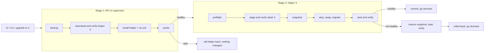

# Upgrade helper: design and plan

**Status:** built for 2.4.0 (phases U0 to U4); U5 is LIN-02, planned for 2.5.0.
Written 2026-11-24. [How it was built](#how-it-was-built) lists where the code
differs from this plan. Operating it: `FEATURES_AND_CONFIG_FLAGS.md`, "Upgrades".

Goal: one click (or one command) moves an install from any supported version to
the next one, including the parts an upgrade cannot change today (the
supervisor, its service definition, scheduled tasks), on every platform, and
puts everything back if the result is not healthy.

## What is missing today

The supervisor carries out upgrades (`supervise_upgrade.go`): snapshot, install,
restart the API and UI, health checks, rollback. It cannot finish its own:

| Gap | Effect |
| --- | --- |
| The supervisor does not restart itself. | It runs the old program until the next service restart (`supervisor_restart_pending`). |
| Service definitions change only when `v2-install-service` is run by hand. | The 2.4.0 systemd sandbox (LIN-01) and Windows folder permissions (WIN-02) do not reach upgraded hosts. |
| Schedule units change only when the schedule is saved again. | Same, for scheduled runs. |
| The old version's code runs the upgrade. | A bug in the 2.3 upgrade code cannot be fixed by 2.4. |
| Rollback covers programs, not service definitions or migrated configuration. | A bad unit cannot be put back automatically. |
| The service must be able to write its own units. | It has to run as root (LIN-02). |

## The idea

A small **update helper**, outside the service, that does nothing until an
upgrade is requested. Upgrades run in two stages:

1. **Helper first.** The running API or supervisor fetches the *target
   version's* helper, verifies it, installs it with its own service definition,
   and starts it in probe mode. Nothing else has changed yet. If the probe
   fails, the old helper is put back and the upgrade stops.
2. **Then the stack.** The helper, now running the target version's code,
   upgrades the supervisor, API, UI, frontend, service definitions, schedules
   and configuration, checks the result, and commits or rolls back.

So upgrade logic is always the *new* version's, run by a process that survives
every restart it causes.

### The helper

- A subcommand, `ncc-orchestrator upgrade-helper`, not a new program to ship and
  sign. It runs from its **own copy**, `<install>/helper/ncc-upgrade-helper`,
  so replacing `bin/` never touches the running file, and the helper can be a
  version ahead of the stack.
- **Dormant** means no process. It is started by the service manager on request
  and exits when the upgrade is committed, rolled back or refused.
- It never downloads anything the request tells it to. The request names a
  version, an id and who asked. Repository, paths and service name come from
  the helper's own definition.

### Per platform

| Platform | Where it lives while dormant | Started by | Survives | Finishes after a reboot |
| --- | --- | --- | --- | --- |
| Linux, systemd | `ncc-orchestrator-upgrade.service` (oneshot, root) and `.path` watching `run/upgrade/request.json` | the path unit | `systemctl restart` of the stack (own cgroup) | enabled unit with `ConditionPathExists=` on the active journal |
| Windows | task `ncc-orchestrator-upgrade`, SYSTEM, no trigger, no time limit | `schtasks /Run` by the supervisor (SYSTEM) | ending the supervisor task | a boot trigger added at the start of stage 2 and removed at the end |
| macOS | LaunchDaemon `…ncc-orchestrator.upgrade` with `WatchPaths`, no `KeepAlive` | launchd | `launchctl kickstart -k` of the stack | `RunAtLoad`; exits at once without an active journal |
| Started by hand, no service | nothing installed | a detached process from the API or CLI | the API's exit | `v2-start` resumes an active journal before starting servers |
| Kubernetes, Helm | nothing; hook Jobs exist only during `helm upgrade` | `pre-upgrade` and `post-upgrade` hooks | pod replacement | Helm; `--atomic` rolls back |
| Kubernetes, kustomize | nothing | an optional Job manifest before and after `kubectl apply` | pod replacement | `kubectl rollout undo` |
| Plain containers | nothing; the image is the unit of upgrade | not applicable | not applicable | the previous image tag |

In Kubernetes and containers the program files are immutable, so the helper's
job there is the checks around the rollout: before it, a backup, volume space,
version skew and permissions; after it, that the API, UI and runner all report
the target version. The UI shows the new version and the exact command to run.
It gets no permission to change Deployments.

### Stage 1 in detail

| Step | Done by | Fails when | Then |
| --- | --- | --- | --- |
| Refuse if a run, restore or upgrade is active | API | one is active | say which, change nothing |
| Pre-update backup | API | backup fails | stop |
| Download the target release's orchestrator for this platform | API or supervisor | network, rate limit | stop |
| Verify: checksum, release signature, `upgrade-manifest.json` allows this `from` version | API or supervisor | any mismatch, or an unsigned release on a build that embeds a key | stop |
| Install as `helper/…new`, keep the previous as `helper/…prev` | supervisor | no write access | stop, offer the manual command |
| Rewrite the helper's unit, task or plist from the *new* helper (`upgrade-helper print-definition`) | supervisor | service manager refuses | previous helper and definition back |
| Probe: start under that definition with `--probe` | service manager | not up, wrong version, exits, or a check fails within 60 s | previous helper and definition back |

**"Running and stable"** is the probe: started by the service manager under its
real definition (not from a shell), reports the target version, proves it can
write the unit folder, replace a file in `bin/`, query and control the stack
service, reach its own state folder, sees enough disk, and stays up 15 seconds
with a heartbeat. This catches a sandbox, SELinux or permission problem before
anything in the stack changes.

### Stage 2 in detail

The helper writes a journal (`run/upgrade/journal.json`, fsync per step) so it
can resume. `v2-upgrade-state.json` keeps its format, so the UI needs no new
polling.

1. **Preflight**: lock, disk space, versions, trusted-stack ledger, no run.
2. **Stage**: download the stack archive, verify signature and checksums,
   unpack to `run/upgrade/stage/`. The live files are untouched; this is the
   slow part and happens while everything still runs.
3. **Snapshot**: `bin/`, `frontend-dist/`, **service, schedule and helper
   definitions as installed**, and the configuration files a migration will
   change. Hashes go into the ledger (`UpgradeSnapshot`, SEC-19).
4. **Stop** the stack. Expected downtime from here to step 7 is under a minute.
5. **Swap** program files (existing transaction: aside-rename, SELinux label).
6. **Migrate**, each step idempotent, recorded and reversible: service
   definition, schedule units or tasks, file permissions, configuration schema.
   Local edits to a unit are kept as a drop-in, never overwritten silently: a
   definition that does not match the one we generated is reported and kept
   unless the person chose "replace".
7. **Start** the service with the new supervisor.
8. **Verify**: supervisor, API and UI report the target version, pass health
   probes and stay up for the verify window; the schedule is still installed;
   the non-disruptive doctor checks pass; sign-in state and run history load.
9. **Commit**: record the set in the ledger, write the audit entry, keep the
   snapshot for 24 hours for a manual **Roll back**, go dormant.

Any failure from step 4 on restores the snapshot (programs, definitions,
configuration), starts the previous version and verifies *that*. If even that
fails, the state says so and names the backup. The new helper stays installed
either way: it must be able to manage the previous version.

### Upgrading from 2.3.x (and any version without the helper)

Old code cannot do stage 1. It does not have to: a 2.3.x upgrade already ends
with the new API running. So the 2.4 API, at start, **adopts** the host:

1. Wait until `v2-upgrade-state.json` is `done` or absent, and the stack has
   been healthy for two minutes. Never interfere with a 2.3 upgrade in progress.
2. Install and probe the helper (stage 1 without the download: the program is
   already verified and installed).
3. Run stage 2 with nothing to swap: snapshot definitions, migrate service and
   schedules, restart the supervisor, verify, commit or put the old definitions
   back.

That delivers LIN-01 and the new supervisor to 2.3.x hosts with no manual step.
If the API is not privileged (hand-started, no service), it shows a
**Finish upgrade** card with the one command to run instead. Setting
`NCC_UPGRADE_ADOPT=0` turns adoption off. The existing apply-update watcher
stays for one more minor version, so `ncc-orchestrator update` on the command
line keeps working; from then on that command hands over to the helper.

### What the person sees

- **Updates & backups → Upgrade**: version, notes, and a **plan** before
  anything happens: checks passed or failed, expected downtime, and what will
  change (programs, service definition diff, schedules, configuration keys).
- One progress list across both stages that survives the restart; the page
  keeps polling and reconnects by itself.
- The end states are *Upgraded*, *Rolled back (why)* or *Nothing was changed
  (why)*, each with the log and, for 24 hours, **Roll back**.
- Command line, same engine: `ncc-orchestrator upgrade --plan | --to X |
  --status | --rollback`, and `--bundle FILE` for hosts without internet access
  (stack archive, checksums and signature, uploaded or copied).
- Channel: stable installs see stable releases. An install running a release
  candidate sees candidates until the release is out. Others opt in with
  `--include-prerelease` (done for RC 1).

### Release manifest

Each release adds `upgrade-manifest.json` (listed in the signed checksums):
`version`, `min_from`, `helper_protocol`, `migrations`, `config_schema`,
`downtime_hint`. It lets an old install say "go to 2.6 first" instead of
failing halfway.

### Security rules

- Request folder: only the service can write it; content is treated as hostile
  (size limit, strict version pattern, unknown fields rejected).
- No downgrade, except to the set saved in the snapshot and recorded in the
  ledger.
- Signature required whenever the running build embeds a release key; no flag
  in a request can relax this.
- Helper, journal and snapshot folders are writable by root or SYSTEM only.
- Every stage writes an audit entry: who asked, from, to, outcome.
- This is the piece LIN-02 waits for. With unit files and `systemctl` owned by
  the helper, the API and UI can run as an unprivileged user and the service
  can turn on `ProtectSystem=strict`.

## Work plan

| Phase | Content | Target | Size | Done when |
| --- | --- | --- | --- | --- |
| U0 | Pre-release support in the updater and release workflow | RC 1 | S | built; proven when RC 1 is published and an install updates to it |
| U1 | Helper core (journal, stage 1 and 2, rollback), Linux systemd, adoption from 2.3.x | RC 2 | L | 2.3.0 → RC 2 in a systemd container ends on the sandboxed unit with no manual step; every fault below rolls back |
| U2 | Windows tasks and macOS launchd | RC 2 or 3 | M | same on Windows Server 2022 and macOS; supervisor, folder permissions and schedule migrated |
| U3 | CLI, hand-started stacks, UI plan and progress, `--bundle` | RC 3 | M | one flow in the UI on every host type; offline upgrade works |
| U4 | Helm hooks, kustomize Jobs, UI command for containers | RC 3 | M | kind test: failed post-check with `--atomic` returns to the old revision |
| U5 | LIN-02: unprivileged API and UI, `ProtectSystem` | 2.5.0 | L | service runs as `ncc`; only the helper is root |

### Tests

Fault injection at every step, each must end in *Upgraded*, *Rolled back* or
*Nothing was changed*, never in between:

- kill the helper, the supervisor, the API; reboot the host, at each step;
- full disk while staging, at snapshot and at swap;
- wrong checksum, wrong or missing signature, truncated archive;
- new API that crashes, hangs, or answers unhealthy; new supervisor that exits;
- a unit the service manager rejects; SELinux enforcing; a read-only `/etc`;
- locally edited unit; schedule of each type; two upgrade requests at once;
- a run started during staging; clock jump; file locked by antivirus (Windows).

Upgrade matrix per release candidate: from 2.2.1, 2.3.0 and the previous
candidate, on Rocky 9, Ubuntu 24.04, Debian 12 (systemd containers, and one
real Rocky host), Windows Server 2022, macOS, kind; service and hand-started.
The Linux part runs in CI.

## Decisions

1. The helper ships in **2.4.0**.
2. Adoption is **on** by default (`NCC_UPGRADE_ADOPT=0` turns it off).
3. Locally edited units are **kept**: added lines move to a drop-in, and a unit
   with a changed command or user is left alone and reported.

## How it was built

Code: `cmd/ncc-orchestrator/upgrade_*.go` (engine, stage 1, platforms, CLI) and
`cmd/ncc-api-server/upgradehelper.go`.

| Plan | Built |
| --- | --- |
| Path unit on `request.json`; boot trigger on Windows added for stage 2 | One file, `run/upgrade/wake`, exists while there is work. systemd and launchd watch it. On Windows the helper is started on request and at boot, and every minute while there is work: Task Scheduler does not restart a program that was killed. |
| Probe for 15 s with a heartbeat | 5 s after the checks; the job's heartbeat is every 15 s. |
| The helper downloads the stack | Stage 1 downloads, the helper verifies the signature and checksum again before it unpacks. The helper has no network code path. |
| The helper's program comes from the release's orchestrator asset | It comes from the same verified stack archive. |
| Helm pre-upgrade hook checks backup, space and skew | Two pre-upgrade Jobs. First the new images are pulled and started once. Then `ncc-orchestrator upgrade-preflight` runs as the API's user, on the API's node, with the data volume mounted: version skew (no downgrade; not below `min_from`, set as `upgradeCheck.preCheck.minFrom`, using the same rule as the manifest check), a file written and removed in `/data` and its folders, free space against `minFreeSpace` (default 512Mi, checked again after the backup), and a backup taken through the API's backup endpoint and verified. The first three run before the backup; any failure stops the upgrade with nothing changed, and `--atomic` keeps the old revision. The post-upgrade Job (`upgrade-verify`) waits for five answers in a row in which the API, the UI server (`X-NCC-UI-Version`) and the runner image all report the target version. The same Jobs are in `k8s/upgrade-check-job.yaml` for kustomize. Not built: `min_from` is a chart value, not read from a release's `upgrade-manifest.json` (a hook has no network), and the runner is checked by the image the chart sets, not by looking inside the CronJob. |
| `helper_protocol`, `min_from`, `migrations`, `config_schema`, `downtime_hint` in the manifest | `schema`, `version`, `helper_protocol`, and optional `min_from` and `downtime_hint` (set at release time by `NCC_UPGRADE_MIN_FROM` and `NCC_UPGRADE_DOWNTIME_HINT`). `min_from` is enforced for a download and for a `--bundle` whose checksums list the manifest. The plan shows `downtime_hint`, or "under a minute" without one. `migrations` and `config_schema` have no reader yet. |
| Replace a locally edited unit on request | `upgrade --replace-edited` (and `upgrade-adopt --replace-edited`), and a checkbox in the plan in the UI. The plan shows the diff of each definition first. The default stays *keep*. The snapshot holds the edited unit, so a rollback puts it back. |
| `ncc-orchestrator update` hands over to the helper | `update` hands over to `upgrade` when the helper can do the same job: a stack with an update helper, releases of this repository, and no `--check`, `--binary-url`, `--skip-checksum-verify` or `--allow-major-upgrade`. Otherwise it says why and replaces the programs only (`--programs-only`, or `NCC_UPDATE_PROGRAMS_ONLY=1`, forces this; the supervisor and the API use it). Before it replaces anything it saves the programs and the configuration, so **Roll back** works for 24 hours after it too. |
| Plan: checks, downtime, changes | `upgrade --plan` and the UI list checks (service, permissions, no other upgrade, disk space, release), the expected downtime, the programs replaced, the configuration saved, and each definition with its action and diff. |
| End states with the log and Roll back for 24 hours | *Upgraded*, *Rolled back; the previous version is running* (why), and *Nothing was changed* (why) for a job that stopped before it changed anything. **Roll back** is offered from `run/upgrade/rollback.json` while the snapshot is kept: after an upgrade, an adoption (the service definitions go back, the programs stay) or `update`. |

Since then: on Windows the service has a second task, `ncc-orchestrator-watchdog`
(WIN-07); upgrades, rollback and adoption include it.

A Windows task with a name of its own is found by its action: the task that runs
`supervise` of this install's `ncc-orchestrator.exe`.

Guards found by fault injection: a second upgrade request no longer overwrites
the progress of the running job; a scheduled run that started during staging
stops the upgrade before the service is stopped (systemd), and the job ends as
*Nothing was changed*; a wall-clock jump while the new version is checked moves
the deadline instead of failing or passing the checks.

Known limits: the 2.3.x to 2.4.0 step itself is still carried out by the 2.3.x
supervisor, and adoption finishes it two minutes after 2.4.0 starts. The guard
for a scheduled run exists for systemd only; Windows and launchd stop the
service while a run goes on, as before. `update` without the helper (a
hand-started stack, another repository, `--binary-url`) keeps the programs-only
path; its rollback needs the snapshot, which is saved only when the helper could
restart that stack and `update` runs with the rights to change it. A file locked by antivirus, SELinux enforcing and a read-only
`/etc` are not rehearsed.

Tests: `cmd/ncc-orchestrator/upgrade_gaps_test.go` covers the diff, replace on
request, rollback after adoption and after `update`, the hand-over rules of
`update`, a Windows task of another name, `min_from` in a bundle, and fault
injection: a full disk while staging, at the snapshot and at the swap, a
truncated archive, two requests at once, a run started during staging, and a
clock jump.

Rehearsed with `scripts/upgrade-e2e.sh` (also in CI on Ubuntu, macOS and
Windows): upgrade with a locally added unit line, rollback by hand, a release
that does not start, a changed package, a truncated package whose checksum
matches, two upgrade requests at once, the helper killed while installing and
while checking; each from a service manager and from `v2-start`. With a service
manager it also kills the supervisor. Under systemd it also replaces an edited
unit with `--replace-edited` and gets it back with a rollback, and fills the
disk at the snapshot (a 1 MB tmpfs) when the host can mount one. Adoption was
rehearsed from 2.2.1 and 2.3.0 under systemd 257, and the Helm hooks on kind.
